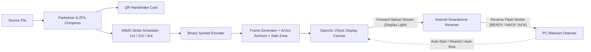

  # MIMO Optical Communication

A Python desktop transmitter for high-speed optical MIMO and Optical Camera Communication (OCC / OWC) experiments. The project implements a high-throughput, camera-compatible optical transmission pipeline: files are compressed and packetized with CRC-32 integrity, a pre-flight QR handshake is displayed for the receiver, spatial symbol grids are rendered via OpenGL at calibrated frame rates, and a **closed-loop reverse optical link** enables automated handshake and flow control via smartphone flashlight strobe pulses detected by the PC webcam.

> 📖 **Android Receiver Synchronization Guide:**  
> For complete specifications, geometry coordinates, packet layouts, and Android source code updates, see [RECEIVER_INTEGRATION_GUIDE.md](file:///c:/Users/pratik/Coding/Mimo-optical-communication/RECEIVER_INTEGRATION_GUIDE.md).

---

## 📌 Table of Contents
1. [Current Status & Key Features](#current-status--key-features)
2. [How the System Works](#how-the-system-works)
3. [Closed-Loop Reverse Optical Link](#closed-loop-reverse-optical-link)
4. [High-Level Architecture](#high-level-architecture)
5. [Repository Layout](#repository-layout)
6. [Desktop UI & Live Workflow](#desktop-ui--live-workflow)
7. [Canonical Protocol Contract](#canonical-protocol-contract)
8. [Physical Frame Geometry & Optical Dimensions](#physical-frame-geometry--optical-dimensions)
9. [Detailed Code File Reference](#detailed-code-file-reference)
10. [Performance Bottlenecks & Optimization Roadmap](#performance-bottlenecks--optimization-roadmap)
11. [Setup, Testing & Verification](#setup-testing--verification)

---

## Current Status & Key Features

The project is in its live transmitter configuration and supports both open-loop simplex transmission and closed-loop bidirectional optical communication:

- **Pre-Flight QR Handshake:** Compact JSON metadata (`session_id`, `filename`, `file_size`, `total_packets`, `mimo_mode`, `symbol_mode`, `packet_size`) rendered on a high-contrast white card framed by corner anchors.
- **Closed-Loop Reverse Optical Link (Webcam + Torch):**
  - **1 Pulse (READY):** Android receiver locks onto the screen and triggers PC auto-start.
  - **2 Pulses (NACK):** Receiver signals packet loss stall, rewinding transmitter carousel index.
  - **3 Pulses / Sustained Strobe (ACK):** Receiver signals 100% transfer completion, triggering PC auto-stop.
- **Spatial MIMO Multiplexing:** Supports 1x1 SISO, 2x2 MIMO (4 parallel quadrants), and 4x4 MIMO (16 spatial tiles).
- **Flexible MIMO Transmission Strides:**
  - `Stride 4`: Pure parallel transmission (4 distinct packets per frame for maximum throughput).
  - `Stride 2`: Space-time redundancy (quadrants 0 & 1 send current packets; quadrants 2 & 3 repeat previous packets).
  - `Stride 1`: Sliding carousel mode.
- **Dynamic Compression:** Automatic `ZFIL` zlib compression level 6 with embedded 44-byte `FileMetadata` (original size + SHA-256 hash).
- **Geometric Anchoring & Safe Zone:** Clockwise OpenCV ArUco anchors (`DICT_4X4_50`, IDs 0, 1, 2, 3) surrounded by a 10% black camera safe-zone margin.
- **Hardware-Accelerated Display:** Qt6 OpenGL widget (`OpticalGLRenderer`) with VSync timing to prevent horizontal screen tearing.
- **Deterministic Whitening Padding:** Padding bytes derived from bit shifts to eliminate periodic vertical striping on short final packets.

---

## How the System Works

The transmission pipeline follows these stages:

1. A user selects a file in the desktop UI (`SendPage`).
2. `Packetizer` inspects the file, compresses via zlib if beneficial (`ZFIL`), computes the SHA-256 checksum, prepends 44-byte `FileMetadata` to packet #0, and slices into CRC-32 protected chunks.
3. `qr_metadata.py` creates session handshake metadata and generates a centered QR code.
4. The receiver aligns to the screen, parses the QR code, and sends a 1-pulse flashlight READY strobe.
5. `OpticalFeedbackDetector` on the PC webcam senses the pulse and signals `TransmissionStateMachine` to enter `TRANSMITTING` mode.
6. `PrecisionTimer` drives frame rendering at the configured rate (10–15 FPS).
7. Each packet is mapped to a square binary symbol matrix with deterministic whitening padding by `SymbolEncoder`, composited into spatial quadrants by `FrameGenerator`, and displayed via OpenGL.
8. If the receiver misses packets and stalls, it pulses twice (NACK), prompting the PC to rewind its carousel position.
9. Upon completion, the receiver emits a completion strobe (ACK), and the PC automatically stops and returns to standby.

---

## Closed-Loop Reverse Optical Link

The reverse link operates using the smartphone's camera flashlight torch detected by the PC's standard webcam:

| Pattern | Flash Sequence | Semantic Meaning | Transmitter Behavior |
|:---|:---|:---|:---|
| **READY** | 1 pulse (~150–280ms) | Receiver locked on ArUco & metadata parsed | PC automatically transitions from `WAITING_FOR_RECEIVER` to `TRANSMITTING` |
| **NACK** | 2 pulses (~130–220ms, ~120–250ms gap) | Packet loss / carousel stalled | PC rewinds packet carousel index by `stride * 2` |
| **ACK** | 3 pulses or sustained $\ge 650$ms strobe | 100% packets received & SHA-256 verified | PC automatically calls `stop_transmission()` |

Detection is performed in a background worker thread (`OpticalFeedbackDetector`) utilizing:
1. **Saturated Pixel Cluster Counting:** Evaluates pixels with intensity $\ge 245$ within the smartphone's field-of-view ROI.
2. **P98 Flare Tracking:** Tracks lens flare diffraction spikes to tolerate off-axis and tilted smartphone angles.
3. **Dynamic Ambient Baseline Tracking:** Hysteresis filtering adapts to room lighting changes.

---

## High-Level Architecture



---

## Repository Layout

```text
Mimo-optical-communication/
├── .gitignore
├── README.md
├── RECEIVER_INTEGRATION_GUIDE.md
├── requirements.txt
├── run.bat
├── pc/
│   ├── __init__.py
│   ├── benchmark_results.json
│   ├── main.py
│   ├── preview_stage2.py
│   ├── run_stage3_demo.py
│   ├── test_frame_output.png
│   ├── app/
│   │   ├── __init__.py
│   │   ├── data/
│   │   │   ├── __init__.py
│   │   │   ├── checksum.py
│   │   │   ├── file_reader.py
│   │   │   └── packetizer.py
│   │   ├── diagnostics/
│   │   │   ├── __init__.py
│   │   │   └── benchmark.py
│   │   ├── mimo/
│   │   │   ├── __init__.py
│   │   │   ├── scheduler.py
│   │   │   └── splitter.py
│   │   ├── optical/
│   │   │   ├── __init__.py
│   │   │   ├── aruco_generator.py
│   │   │   ├── frame_generator.py
│   │   │   ├── gl_renderer.py
│   │   │   ├── optical_feedback_detector.py
│   │   │   ├── qr_metadata.py
│   │   │   ├── state_machine.py
│   │   │   ├── symbol_encoder.py
│   │   │   └── timing.py
│   │   ├── protocol/
│   │   │   ├── __init__.py
│   │   │   ├── crc.py
│   │   │   ├── fec.py
│   │   │   ├── header.py
│   │   │   ├── packet.py
│   │   │   └── sequence.py
│   │   ├── security/
│   │   │   ├── __init__.py
│   │   │   └── encryption.py
│   │   └── ui/
│   │       ├── __init__.py
│   │       ├── diagnostics_page.py
│   │       ├── home_page.py
│   │       ├── main_window.py
│   │       ├── send_page.py
│   │       ├── settings_page.py
│   │       ├── transmission_page.py
│   │       └── components/
│   │           ├── __init__.py
│   │           ├── display_canvas.py
│   │           └── stats_panel.py
│   └── tests/
│       ├── __init__.py
│       ├── test_occ_upgrades.py
│       ├── test_optical_feedback.py
│       ├── test_packet.py
│       ├── test_stage2.py
│       ├── test_stage3.py
│       ├── test_stage4.py
│       └── test_stage5.py
```

---

## Desktop UI & Live Workflow

The application entry point is `pc/main.py`. The interface provides five tabs:

- **Home:** System overview, status overview, and operating mode guide.
- **Send:** File picker, payload size slider (64 to 512 bytes), MIMO mode selector (1x1, 2x2, 4x4), MIMO stride selector (4 - Parallel, 2 - Redundancy, 1 - Carousel), Symbol mode (BINARY), and Target FPS selector.
- **Transmission:** Primary optical canvas displaying the pre-flight QR code or live spatial symbol frames, with SHOW QR, START, PAUSE, RESUME, STOP, and RESET controls.
- **Settings:** Optical feedback toggle, webcam device index, auto-stop on ACK checkbox, ArUco corner marker toggle, safe zone border toggle, and FEC parity symbol count.
- **Diagnostics:** Real-time timing jitter graphs, benchmarks runner, and live log view.

### Status Panel Telemetry
The right-hand status panel reports live transmission metrics:
- **State:** `WAITING_FOR_RECEIVER` or `TRANSMITTING`
- **QR Status:** `GENERATED` / `NOT GENERATED`
- **Session ID:** e.g. `SESS-AB12`
- **Filename / Size / Total Packets**
- **Current Packet Index / Carousel Cycle**
- **Transmitted Frame Count / Actual FPS**
- **Optical Feedback Status:** `NOT AVAILABLE` / `LOCKED (Receiver ready)` / `NACK (Retransmission requested)` / `RECEIVED (ACK - Transfer Complete)`

---

## Canonical Protocol Contract

### Packet Wire Format (`pc/app/protocol/packet.py`)
Packets are serialized in standard big-endian byte order:

| Offset | Size (Bytes) | Field Name | Type | Description |
|:---|:---|:---|:---|:---|
| 0 | 2 | Magic Bytes | ASCII | Fixed value `b"MO"` (`0x4D, 0x4F`) |
| 2 | 1 | Protocol Version | uint8 | Version identifier (`0x01`) |
| 3 | 1 | Frame Type | uint8 | `0=IDLE`, `1=CALIB`, `2=SYNC`, `3=CONFIG`, `4=DATA`, `5=END` |
| 4 | 1 | Channel ID | uint8 | Spatial channel index (`0` for 1x1; `0..3` for 2x2; `0..15` for 4x4) |
| 5 | 4 | Sequence ID | uint32 | Monotonic zero-based sequence counter |
| 9 | 2 | Payload Length | uint16 | Length of data payload $N$ in bytes |
| 11 | $N$ | Payload | bytes | File chunk data (Packet #0 includes 44B FileMetadata) |
| $11 + N$ | 4 | CRC-32 | uint32 | IEEE 802.3 CRC-32 checksum computed over bytes $0 \dots 10 + N$ |

Total overhead per packet is **15 bytes** (11-byte header + 4-byte CRC).

### Packet #0 FileMetadata Header
Packet #0 embeds a 44-byte metadata prefix before payload bytes:
- **Magic (4 bytes):** `b"FILE"` (raw uncompressed) or `b"ZFIL"` (zlib compressed).
- **Original File Size (8 bytes):** uint64 big-endian size in bytes.
- **SHA-256 Digest (32 bytes):** Cryptographic hash of original uncompressed file.

### QR Handshake Schema
Generated by `pc/app/optical/qr_metadata.py`:
```json
{
  "protocol_version": 1,
  "filename": "document.pdf",
  "file_size": 24576,
  "total_packets": 96,
  "mimo_mode": "2x2",
  "symbol_mode": "BINARY",
  "packet_size": 256,
  "session_id": "SESS-E412"
}
```
*Note: A compact variant using keys `{"v", "f", "s", "p", "m", "y", "z", "id"}` is also supported for faster QR acquisition.*

---

## Physical Frame Geometry & Optical Dimensions

The transmitter frame architecture is strictly calibrated for perspective homography and camera acquisition:

- **Base Frame Canvas:** $800 \times 800$ pixels.
- **Camera Safe-Zone Border:** 10% black margin ($80\text{px}$) added around all four outer edges, yielding a total emitted frame of **$960 \times 960$ pixels**.
- **Border & Grid Lines:** 4-pixel white border enclosing the base frame and 3-pixel black grid lines separating MIMO quadrants.
- **ArUco Corner Anchors (`DICT_4X4_50`):**
  - **Marker Size:** $44 \times 44$ pixels.
  - **Marker Margin (White Quiet Zone):** $6\text{px}$ on all four sides (total footprint = $56 \times 56\text{px}$).
  - **Clockwise Placement:**
    - ID 0: Top-Left (TL)
    - ID 1: Top-Right (TR)
    - ID 2: Bottom-Right (BR)
    - ID 3: Bottom-Left (BL)
- **Central Data Area:** Resides strictly within inner bounds $(56, 56)$ to $(744, 744)$, forming a pure **$688 \times 688$ pixel** data area with zero ArUco marker pixel overlap.
- **Receiver Homography Mapping:** Inner corners of the ArUco markers span $50\text{px}$ to $750\text{px}$ ($700\text{px}$ span). The Android receiver offsets homography destination coordinates outward by $\approx 4.465\text{px}$ to warp directly onto the $512 \times 512$ data matrix with zero boundary distortion.

---

## Detailed Code File Reference

### Project Entry Points
- [`pc/main.py`](file:///c:/Users/pratik/Coding/Mimo-optical-communication/pc/main.py): Application entry point; initializes Qt `QApplication`, configures dark Fusion theme, creates `MainWindow`, and starts event loop.
- [`run.bat`](file:///c:/Users/pratik/Coding/Mimo-optical-communication/run.bat): Windows batch script that activates virtual environment and executes `python -m pc.main`.

### Data Layer (`pc/app/data/`)
- [`checksum.py`](file:///c:/Users/pratik/Coding/Mimo-optical-communication/pc/app/data/checksum.py): Cryptographic SHA-256 helpers for byte arrays and streaming disk files.
- [`file_reader.py`](file:///c:/Users/pratik/Coding/Mimo-optical-communication/pc/app/data/file_reader.py): File inspection utilities and chunked streaming generator.
- [`packetizer.py`](file:///c:/Users/pratik/Coding/Mimo-optical-communication/pc/app/data/packetizer.py): Slices source files into CRC-protected `Packet` objects, handles `FileMetadata` serialization, and applies dynamic zlib compression (`ZFIL`).

### MIMO Spatial Multiplexing (`pc/app/mimo/`)
- [`splitter.py`](file:///c:/Users/pratik/Coding/Mimo-optical-communication/pc/app/mimo/splitter.py): Defines `SpatialLayout` enum (`1x1`, `2x2`, `4x4`), quadrant coordinate mapping, and round-robin packet distribution.
- [`scheduler.py`](file:///c:/Users/pratik/Coding/Mimo-optical-communication/pc/app/mimo/scheduler.py): Channel queue scheduler managing per-channel queues and next-packet dispatch.

### Optical Transmission Layer (`pc/app/optical/`)
- [`aruco_generator.py`](file:///c:/Users/pratik/Coding/Mimo-optical-communication/pc/app/optical/aruco_generator.py): Generates OpenCV `DICT_4X4_50` markers (IDs 0, 1, 2, 3) and stamps them into corner positions with white quiet-zone padding.
- [`frame_generator.py`](file:///c:/Users/pratik/Coding/Mimo-optical-communication/pc/app/optical/frame_generator.py): Composites spatial channel symbol matrices, internal grid lines, outer borders, ArUco anchors, and the 10% black safe-zone border. Also renders the centered Phase 1 QR handshake card.
- [`gl_renderer.py`](file:///c:/Users/pratik/Coding/Mimo-optical-communication/pc/app/optical/gl_renderer.py): Hardware-accelerated Qt `QOpenGLWidget` performing aspect-correct BGR frame display with OpenGL VSync locking to prevent tearing.
- [`optical_feedback_detector.py`](file:///c:/Users/pratik/Coding/Mimo-optical-communication/pc/app/optical/optical_feedback_detector.py): Multi-feature optical feedback listener running on a background thread. Captures PC webcam frames, tracks saturated pixel clusters and P98 diffraction spikes, and emits Qt signals for READY, NACK, and ACK pulse sequences.
- [`qr_metadata.py`](file:///c:/Users/pratik/Coding/Mimo-optical-communication/pc/app/optical/qr_metadata.py): Dataclass representation of session metadata and QR code generator (`qrcode` library) with support for standard and compact JSON encoding.
- [`state_machine.py`](file:///c:/Users/pratik/Coding/Mimo-optical-communication/pc/app/optical/state_machine.py): Thread-safe state machine managing transitions between `WAITING_FOR_RECEIVER` and `TRANSMITTING`.
- [`symbol_encoder.py`](file:///c:/Users/pratik/Coding/Mimo-optical-communication/pc/app/optical/symbol_encoder.py): Maps byte packets into 2D optical symbol grids (BINARY and differential MANCHESTER). Features deterministic whitening padding to maintain constant grid dimensions across all packets.
- [`timing.py`](file:///c:/Users/pratik/Coding/Mimo-optical-communication/pc/app/optical/timing.py): High-precision `QThread` clock using `time.perf_counter_ns()` with drift compensation to maintain stable 10–15 FPS output.

### Protocol Layer (`pc/app/protocol/`)
- [`crc.py`](file:///c:/Users/pratik/Coding/Mimo-optical-communication/pc/app/protocol/crc.py): Wrapper for standard IEEE 802.3 32-bit CRC.
- [`fec.py`](file:///c:/Users/pratik/Coding/Mimo-optical-communication/pc/app/protocol/fec.py): Reed-Solomon Forward Error Correction helper based on `reedsolo.RSCodec` (supporting RS(255, 223)).
- [`header.py`](file:///c:/Users/pratik/Coding/Mimo-optical-communication/pc/app/protocol/header.py): Protocol constants and frame types.
- [`packet.py`](file:///c:/Users/pratik/Coding/Mimo-optical-communication/pc/app/protocol/packet.py): Canonical packet definition, byte serialization (`to_bytes()`), deserialization (`from_bytes()`), and CRC validation.
- [`sequence.py`](file:///c:/Users/pratik/Coding/Mimo-optical-communication/pc/app/protocol/sequence.py): Monotonic uint32 sequence counter.

### User Interface (`pc/app/ui/`)
- [`main_window.py`](file:///c:/Users/pratik/Coding/Mimo-optical-communication/pc/app/ui/main_window.py): Top-level application shell hosting tabs, telemetry sidebar, and navigation actions.
- [`home_page.py`](file:///c:/Users/pratik/Coding/Mimo-optical-communication/pc/app/ui/home_page.py): Home guide and system status dashboard.
- [`send_page.py`](file:///c:/Users/pratik/Coding/Mimo-optical-communication/pc/app/ui/send_page.py): File selection and transmission parameter configuration form.
- [`transmission_page.py`](file:///c:/Users/pratik/Coding/Mimo-optical-communication/pc/app/ui/transmission_page.py): Core transmission controller managing OpenGL canvas, packet carousel loop, MIMO stride dispatch, and reverse optical feedback slots.
- [`settings_page.py`](file:///c:/Users/pratik/Coding/Mimo-optical-communication/pc/app/ui/settings_page.py): Configuration page for optical feedback webcam index, auto-stop on ACK, MIMO defaults, and tracking borders.
- [`diagnostics_page.py`](file:///c:/Users/pratik/Coding/Mimo-optical-communication/pc/app/ui/diagnostics_page.py): Performance metrics, benchmark runner, and event logger.
- [`components/display_canvas.py`](file:///c:/Users/pratik/Coding/Mimo-optical-communication/pc/app/ui/components/display_canvas.py): Specialized canvas subclass for optical display.
- [`components/stats_panel.py`](file:///c:/Users/pratik/Coding/Mimo-optical-communication/pc/app/ui/components/stats_panel.py): Compact telemetry widget displaying active state, FPS, and throughput.

### Test Suites (`pc/tests/`)
- [`test_occ_upgrades.py`](file:///c:/Users/pratik/Coding/Mimo-optical-communication/pc/tests/test_occ_upgrades.py): Verifies Manchester reversible encoding, full grid geometry preservation, clockwise ArUco anchor coordinates, and constant terminal packet padding dimensions.
- [`test_optical_feedback.py`](file:///c:/Users/pratik/Coding/Mimo-optical-communication/pc/tests/test_optical_feedback.py): Tests optical feedback detector initialization, single-pulse READY detection, 2-pulse NACK detection, 3-pulse ACK detection, sustained strobe timeout, and multi-feature flare processor.
- [`test_packet.py`](file:///c:/Users/pratik/Coding/Mimo-optical-communication/pc/tests/test_packet.py): Tests packet wire serialization, deserialization, CRC corruption rejection, and length boundaries.
- [`test_stage2.py`](file:///c:/Users/pratik/Coding/Mimo-optical-communication/pc/tests/test_stage2.py): Tests symbol encoding, intensity mapping, and matrix reconstruction.
- [`test_stage3.py`](file:///c:/Users/pratik/Coding/Mimo-optical-communication/pc/tests/test_stage3.py): Tests frame rendering, ArUco anchor placement, and safe-zone border addition.
- [`test_stage4.py`](file:///c:/Users/pratik/Coding/Mimo-optical-communication/pc/tests/test_stage4.py): Tests MIMO spatial channel splitting, round-robin distribution, and channel status.
- [`test_stage5.py`](file:///c:/Users/pratik/Coding/Mimo-optical-communication/pc/tests/test_stage5.py): Tests precision timing deadlines, benchmark generation, and Reed-Solomon FEC codecs.

---

## Performance Bottlenecks & Optimization Roadmap

### Why It Works Reliably Today
- **Geometric Invariant Tracking:** Four ArUco markers establish an exact coordinate frame, resilient to camera perspective tilt and rotation.
- **Safe-Zone Inset:** The 10% black border ensures anchors never get cropped by smartphone camera aspect ratios (4:3 vs 16:9).
- **Whitening Padding:** Prevents visual grid compression on terminal packets.
- **Closed-Loop Feedback:** Provides bidirectional synchronization without needing Wi-Fi, Bluetooth, or manual clicking.

### Current Bottlenecks & Limiting Factors
1. **Modulation Density (Binary OOK):** Currently transmitting 1 bit per cell. Upgrading to 4-Color (2 bits/cell) or 8-Color RGB (3 bits/cell) will immediately multiply raw throughput by $2\times$ to $3\times$.
2. **Camera-to-Screen FPS Disparity (Nyquist Limit):** Standard smartphone cameras stream at 30 FPS. To sample frames without Nyquist aliasing or missed transitions, screen frame rate is capped at 10–15 FPS. Upgrading Android to 60 FPS Camera2 High-Speed mode allows screen transmission at 30 FPS.
3. **LCD Liquid Crystal Rise/Fall Latency:** Standard LCD monitors take 5–15ms for liquid crystals to change states. Tearing and half-drawn states during refresh force the receiver's `SyncDetector` to drop transitional frames. OLED or high-refresh-rate displays (120Hz/240Hz) resolve this transition delay.
4. **Packet Erasure Recovery:** Currently, dropped packets require waiting for the carousel to loop around or sending a flash NACK to rewind. Incorporating cross-packet Forward Error Correction (Fountain codes or Reed-Solomon Erasure codes across $K$ packets) will enable mathematical file reconstruction as soon as any $K$ packets arrive.

---

## Setup, Testing & Verification

### Virtual Environment Setup
```bash
# Create virtual environment
python -m venv .venv
.venv\Scripts\activate

# Install dependencies
pip install -r requirements.txt
```

### Running the Transmitter
```bash
# Run application
python -m pc.main
# Or run using convenience script
run.bat
```

### Running Test Suite
```bash
pytest pc/tests
```
All 42 automated tests should pass cleanly.
