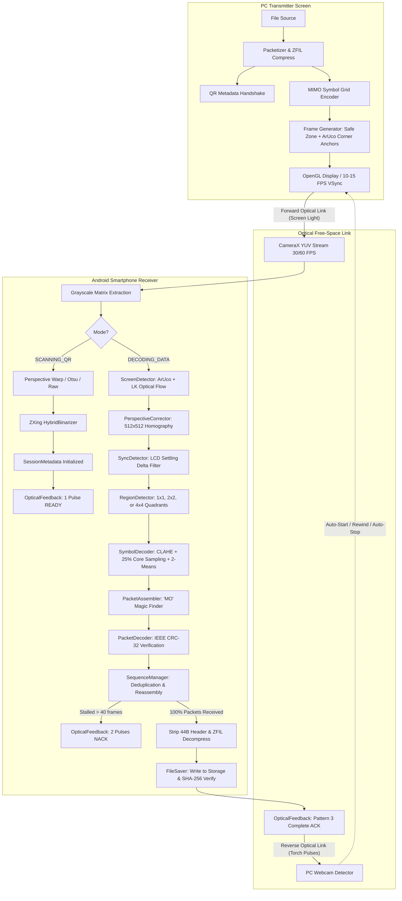

# MIMO Optical Wireless Receiver (Android)

High-performance, camera-based Optical Camera Communication (OCC / OWC) receiver application developed in **Kotlin** and **Jetpack Compose** for Android. The application receives high-speed spatial optical data transmitted from a PC monitor, locks onto corner tracking anchors, corrects perspective distortion via homography, decodes binary symbol matrices across multiple MIMO channels, verifies CRC-32 packet integrity, and reassembles transferred files.

It features a **closed-loop reverse optical link** using the smartphone flashlight torch to signal state transitions (READY, NACK retransmit, ACK completion) back to the PC transmitter's webcam.

---

## 📌 Table of Contents
1. [System Overview & Working Principles](#1-system-overview--working-principles)
2. [End-to-End Pipeline Architecture](#2-end-to-end-pipeline-architecture)
3. [Reverse Optical Link (Flashlight Feedback)](#3-reverse-optical-link-flashlight-feedback)
4. [File-by-File Technical Directory](#4-file-by-file-technical-directory)
5. [Current Bottlenecks & Optimization Roadmap](#5-current-bottlenecks--optimization-roadmap)
6. [Build, Requirements & Setup](#6-build-requirements--setup)

---

## 1. System Overview & Working Principles

When the Android smartphone camera faces the PC transmitter screen:
1. **Physical Line of Sight (LOS):** The smartphone back camera is oriented towards the PC display displaying an $800 \times 800$ pixel optical canvas framed by four ArUco tracking anchors (`DICT_4X4_50`, IDs 0, 1, 2, 3) and a 10% black safe-zone margin.
2. **Phase 1: Pre-Flight Handshake (QR Code):**
   - The PC displays a high-contrast centered QR code containing session metadata JSON (`session_id`, `filename`, `file_size`, `total_packets`, `mimo_mode`, `symbol_mode`, `packet_size`).
   - The Android receiver's `QrMetadataParser` uses ZXing with `HybridBinarizer` on the homography-warped screen area (with fallback to raw camera frame, Otsu binarization, and OpenCV `QRCodeDetector`).
   - Upon scanning, the receiver initializes its session buffers and sequence manager.
3. **Phase 2: Closed-Loop Auto-Start:**
   - The receiver triggers `OpticalFeedbackController.sendReadySignal()`, emitting **1 flash pulse (~280ms)**.
   - The PC webcam detects the pulse and automatically starts optical data transmission.
4. **Phase 3: Spatial MIMO Data Reception:**
   - The PC streams binary symbol matrices at 10–15 FPS in 1x1 SISO, 2x2 MIMO (4 parallel quadrants), or 4x4 MIMO (16 spatial channels).
   - The smartphone captures frames at 30–60 FPS via CameraX with manual continuous autofocus and zero stabilization blur.
5. **Phase 4: Geometric Tracking & Correction:**
   - `ScreenDetector` tracks the four corner ArUco markers using a **60 FPS Lucas-Kanade pyramidal optical flow fast-path (`calcOpticalFlowPyrLK`)** re-anchored every 5 frames by ArUco detection.
   - If one corner is obscured by monitor glare or hand occlusion, geometric recovery reconstructs the missing 4th corner using affine parallelogram geometry.
   - `PerspectiveCorrector` warps the central data area to a normalized $512 \times 512$ matrix with a 4.465 px margin offset to eliminate anchor pixel bleeding.
6. **Phase 5: Inter-Frame Delta & LCD Settling Filter:**
   - `SyncDetector` computes absolute frame differences ($|F_t - F_{t-1}|$). It detects monitor refresh tearing (difference $> 26.0$) and waits for the LCD pixels to settle (difference $< 18.0$) before dispatching clean frames.
7. **Phase 6: Contrast Equalization & Symbol Demodulation:**
   - `RegionDetector` slices the $512 \times 512$ matrix into individual spatial channel matrices (1, 4, or 16 quadrants).
   - `SymbolDecoder` applies **CLAHE** (Contrast Limited Adaptive Histogram Equalization, clip limit 2.5, tile size 8x8), samples the inner 25% core of each cell, and classifies bits using **dynamic 2-Means clustering** (immune to backlight falloff and ambient room lighting).
8. **Phase 7: Bit-Slip Tolerant Packet Assembly & Integrity:**
   - `PacketAssembler` scans bits in each channel for magic bytes `0x4D4F` (`MO`), extracts the 11-byte header, extracts payload, and validates the 32-bit IEEE CRC-32 checksum.
   - `SequenceManager` stores unique packets and tracks missing sequence IDs.
   - If progress stalls for 40 frames (~1.5–2.5s), the receiver emits **Pattern 2 (NACK: 2 flash pulses)**, causing the PC transmitter to rewind its carousel stride.
9. **Phase 8: File Reconstruction & Complete ACK:**
   - Once all packets $0 \dots N-1$ are acquired, `SequenceManager.assembleFileBytes()` extracts and strips the 44-byte `FileMetadata` header from Packet #0 (`FILE` or `ZFIL` magic + uint64 file size + 32-byte SHA-256 hash).
   - If compressed with `ZFIL`, it decompresses the payload using zlib `Inflater`.
   - `FileSaver` writes the assembled file to Android external storage (`Download/MIMO_Transfers/` or application documents) and verifies the SHA-256 digest.
   - The smartphone emits **Pattern 3: Complete ACK (850ms sustained strobe + 2 verification pulses)**.
   - The PC webcam senses the strobe and automatically stops transmission.

---

## 2. End-to-End Pipeline Architecture



---

## 3. Reverse Optical Link (Flashlight Feedback)

The receiver communicates back to the transmitter using structured flashlight torch pulses executed on a coroutine background worker:

| Pattern | Torch Sequence | Semantic Meaning | PC Transmitter Action |
|:---|:---|:---|:---|
| **Pattern 1 (READY)** | 1 pulse (280ms ON) | Receiver locked on ArUco anchors and metadata parsed | PC auto-starts data stream from standby |
| **Pattern 2 (NACK)** | 2 pulses (220ms ON, 250ms OFF) | Carousel stalled / missing sequence IDs | PC rewinds transmission index by `stride * 2` |
| **Pattern 3 (ACK)** | 1 sustained strobe (850ms ON) + 2 pulses (200ms ON / 220ms OFF) | Transfer 100% complete & SHA-256 verified | PC auto-stops transmission and returns to standby |

---

## 4. File-by-File Technical Directory

### 4.1 Root & Configuration Files
- [`build.gradle.kts`](file:///C:/Users/pratik/AndroidStudioProjects/MIMO_Optical_Receiver/build.gradle.kts): Root project Gradle configuration setting Kotlin and Android build tool aliases.
- [`settings.gradle.kts`](file:///C:/Users/pratik/AndroidStudioProjects/MIMO_Optical_Receiver/settings.gradle.kts): Module settings defining repository mirrors and project include paths.
- [`gradle.properties`](file:///C:/Users/pratik/AndroidStudioProjects/MIMO_Optical_Receiver/gradle.properties): JVM heap arguments (`-Xmx2048m`) and AndroidX flags.
- [`build_readme.ps1`](file:///C:/Users/pratik/AndroidStudioProjects/MIMO_Optical_Receiver/build_readme.ps1): PowerShell automation script that aggregates all receiver source code into `SOURCE_CODE_REFERENCE.md`.
- [`topology.txt`](file:///C:/Users/pratik/AndroidStudioProjects/MIMO_Optical_Receiver/topology.txt): Up-to-date repository directory and file tree.
- [`SOURCE_CODE_REFERENCE.md`](file:///C:/Users/pratik/AndroidStudioProjects/MIMO_Optical_Receiver/SOURCE_CODE_REFERENCE.md): Full concatenated reference source code for offline inspection.

### 4.2 Application Module (`app/`)
- [`app/build.gradle.kts`](file:///C:/Users/pratik/AndroidStudioProjects/MIMO_Optical_Receiver/app/build.gradle.kts): App-level Gradle build script configuring SDK 37 (Android 15+), Java 11 compatibility, Jetpack Compose Material3, CameraX (`1.3.3`), OpenCV Android Contrib (`4.5.3.0`), and ZXing Core (`3.5.3`).
- [`app/src/main/AndroidManifest.xml`](file:///C:/Users/pratik/AndroidStudioProjects/MIMO_Optical_Receiver/app/src/main/AndroidManifest.xml): Declares camera hardware requirement (`android.hardware.camera`), camera permissions, flashlight control, application entry point (`MainActivity`), and file provider paths.
- [`app/src/main/java/com/example/mimo_optical_receiver/MainActivity.kt`](file:///C:/Users/pratik/AndroidStudioProjects/MIMO_Optical_Receiver/app/src/main/java/com/example/mimo_optical_receiver/MainActivity.kt): Application entry point initializing OpenCV debug runtime (`OpenCVLoader.initDebug()`), setting up edge-to-edge windowing, and binding the Compose dark theme and navigation host.

### 4.3 Optical & Computer Vision Layer (`camera/`)
- [`CameraManager.kt`](file:///C:/Users/pratik/AndroidStudioProjects/MIMO_Optical_Receiver/app/src/main/java/com/example/mimo_optical_receiver/camera/CameraManager.kt): Composable bridge between Jetpack Compose and CameraX/Camera2. Configures target resolution based on `DeviceProfile`, sets `CONTROL_AF_MODE_CONTINUOUS_PICTURE`, enables auto-exposure, disables video and optical stabilization to prevent motion blur, binds single-instance analyzer, and manages torch controller lifecycle.
- [`FrameAnalyzer.kt`](file:///C:/Users/pratik/AndroidStudioProjects/MIMO_Optical_Receiver/app/src/main/java/com/example/mimo_optical_receiver/camera/FrameAnalyzer.kt): Core frame-by-frame image processing orchestrator. Extracts grayscale Y-plane buffer (reusing allocations), applies orientation rotation, dispatches screen detection, coordinates state machine (`SCANNING_QR` vs `DECODING_DATA`), passes channels to decoder, logs telemetry, and initiates NACK/ACK signals.
- [`ScreenDetector.kt`](file:///C:/Users/pratik/AndroidStudioProjects/MIMO_Optical_Receiver/app/src/main/java/com/example/mimo_optical_receiver/camera/ScreenDetector.kt): Multi-tier screen tracking engine.
  1. *Lucas-Kanade Pyramidal Optical Flow (`calcOpticalFlowPyrLK`)* for 60 FPS fast-path tracking with tremor re-centering every 5 frames.
  2. *ArUco Anchor Detection (`DICT_4X4_50`, IDs 0, 1, 2, 3)* with adaptive window search.
  3. *Parallelogram Glare Recovery* reconstructing a missing 4th corner if 3 markers are visible.
  4. *Secondary Outer Contour Detection* with aspect ratio and symmetry verification.
- [`PerspectiveCorrector.kt`](file:///C:/Users/pratik/AndroidStudioProjects/MIMO_Optical_Receiver/app/src/main/java/com/example/mimo_optical_receiver/camera/PerspectiveCorrector.kt): Computes homography transformation matrix (`Imgproc.getPerspectiveTransform`) mapping detected ArUco inner corners outward by a calibrated offset ($\approx 4.465\text{px}$) to produce a normalized $512 \times 512$ pixel warped matrix with 0 px data grid bleeding.
- [`SyncDetector.kt`](file:///C:/Users/pratik/AndroidStudioProjects/MIMO_Optical_Receiver/app/src/main/java/com/example/mimo_optical_receiver/camera/SyncDetector.kt): Temporal settling and tearing filter. Evaluates pixel delta ($|F_t - F_{t-1}|$). Drops frames transitioning during monitor refresh (mean delta $> 26.0$), ensures stable settling (delta $< 18.0$), and assigns confidence scores.
- [`RegionDetector.kt`](file:///C:/Users/pratik/AndroidStudioProjects/MIMO_Optical_Receiver/app/src/main/java/com/example/mimo_optical_receiver/camera/RegionDetector.kt): Spatial multiplexer dividing the $512 \times 512$ matrix into spatial channel quadrants: 1x1 (full grid), 2x2 (4 quadrants), or 4x4 (16 tiles).
- [`SymbolDecoder.kt`](file:///C:/Users/pratik/AndroidStudioProjects/MIMO_Optical_Receiver/app/src/main/java/com/example/mimo_optical_receiver/camera/SymbolDecoder.kt): High-precision optical demodulator. Applies CLAHE contrast restoration, accesses raw byte memory directly with zero JNI object churn, samples the inner 25% core of each cell, and classifies bits using an iterative **2-Means clustering algorithm** to establish optimal decision boundaries regardless of LCD backlight gradients.
- [`QrMetadataParser.kt`](file:///C:/Users/pratik/AndroidStudioProjects/MIMO_Optical_Receiver/app/src/main/java/com/example/mimo_optical_receiver/camera/QrMetadataParser.kt): Robust QR metadata parser. Uses ZXing `HybridBinarizer` on unskewed perspective-warped matrices, raw frames, and Otsu-thresholded images, falling back to OpenCV `QRCodeDetector`. Decodes JSON payloads with support for full or compact keys (`f`, `p`, `m`, `y`, `z`, `id`, `v`).
- [`OpticalFeedbackController.kt`](file:///C:/Users/pratik/AndroidStudioProjects/MIMO_Optical_Receiver/app/src/main/java/com/example/mimo_optical_receiver/camera/OpticalFeedbackController.kt): Reverse optical transmitter controlling the smartphone rear LED torch via Camera2 `CameraControl.enableTorch()`. Schedules timed pulse trains asynchronously on coroutines for READY, NACK, and completion ACK.

### 4.4 Protocol Layer (`protocol/`)
- [`ProtocolConstants.kt`](file:///C:/Users/pratik/AndroidStudioProjects/MIMO_Optical_Receiver/app/src/main/java/com/example/mimo_optical_receiver/protocol/ProtocolConstants.kt): Protocol specifications defining magic bytes (`0x4D, 0x4F` / `MO`), header size (11 bytes), CRC size (4 bytes), and total overhead (15 bytes).
- [`Packet.kt`](file:///C:/Users/pratik/AndroidStudioProjects/MIMO_Optical_Receiver/app/src/main/java/com/example/mimo_optical_receiver/protocol/Packet.kt): Immutable data representation of an optical packet, including `FrameType` enum (`IDLE`, `CALIB`, `SYNC`, `CONFIG`, `DATA`, `END`), channel ID, sequence ID, payload byte array, and version.
- [`PacketDecoder.kt`](file:///C:/Users/pratik/AndroidStudioProjects/MIMO_Optical_Receiver/app/src/main/java/com/example/mimo_optical_receiver/protocol/PacketDecoder.kt): Deserializes raw byte buffers in big-endian format, verifies magic header, validates length constraints, and recalculates and validates the IEEE CRC-32 checksum.
- [`PacketAssembler.kt`](file:///C:/Users/pratik/AndroidStudioProjects/MIMO_Optical_Receiver/app/src/main/java/com/example/mimo_optical_receiver/protocol/PacketAssembler.kt): Scans demodulated bit streams per channel using a sliding 16-bit window to locate the `0x4D4F` magic header, accommodating bit slips and alignment offsets up to 32 bits.
- [`SequenceManager.kt`](file:///C:/Users/pratik/AndroidStudioProjects/MIMO_Optical_Receiver/app/src/main/java/com/example/mimo_optical_receiver/protocol/SequenceManager.kt): Deduplicates incoming packets, tracks missing packet sequence numbers, calculates transfer progress, extracts and strips the 44-byte `FileMetadata` (`FILE` or `ZFIL` magic, original file size, SHA-256 hash) from Packet #0, and executes zlib decompression if compressed.
- [`SessionMetadata.kt`](file:///C:/Users/pratik/AndroidStudioProjects/MIMO_Optical_Receiver/app/src/main/java/com/example/mimo_optical_receiver/protocol/SessionMetadata.kt): Data model storing handshake metadata parsed from the pre-flight QR code.

### 4.5 User Interface Layer (`ui/`)
- [`AppNavigation.kt`](file:///C:/Users/pratik/AndroidStudioProjects/MIMO_Optical_Receiver/app/src/main/java/com/example/mimo_optical_receiver/ui/AppNavigation.kt): Bottom navigation bar and Jetpack Compose navigation controller managing transitions between Home, Scanner, and Settings screens.
- [`ReceiverUiState.kt`](file:///C:/Users/pratik/AndroidStudioProjects/MIMO_Optical_Receiver/app/src/main/java/com/example/mimo_optical_receiver/ui/ReceiverUiState.kt): Central state container holding camera status, FPS, ArUco telemetry, lock status, packet counts, CRC failure counters, screen bounds, and obstruction alerts.
- [`screens/HomeScreen.kt`](file:///C:/Users/pratik/AndroidStudioProjects/MIMO_Optical_Receiver/app/src/main/java/com/example/mimo_optical_receiver/ui/screens/HomeScreen.kt): Dashboard displaying recent completed transfers, file open/share actions, clear history dialog, and quick launch button to the scanner.
- [`screens/ScannerScreen.kt`](file:///C:/Users/pratik/AndroidStudioProjects/MIMO_Optical_Receiver/app/src/main/java/com/example/mimo_optical_receiver/ui/screens/ScannerScreen.kt): Primary receiver HUD. Renders full-screen camera preview, AR holographic polygon overlay of detected screen corners, link confidence indicator, real-time throughput metrics, channel intensity indicators, obstruction warnings, transfer complete card, and developer diagnostics bottom sheet.
- [`screens/SettingsScreen.kt`](file:///C:/Users/pratik/AndroidStudioProjects/MIMO_Optical_Receiver/app/src/main/java/com/example/mimo_optical_receiver/ui/screens/SettingsScreen.kt): Preferences screen allowing user adjustment of MIMO mode override, sync confidence threshold, core sampling insets, auto-open downloaded files, and diagnostic export settings.
- [`theme/Color.kt`](file:///C:/Users/pratik/AndroidStudioProjects/MIMO_Optical_Receiver/app/src/main/java/com/example/mimo_optical_receiver/ui/theme/Color.kt), [`Theme.kt`](file:///C:/Users/pratik/AndroidStudioProjects/MIMO_Optical_Receiver/app/src/main/java/com/example/mimo_optical_receiver/ui/theme/Theme.kt), [`Type.kt`](file:///C:/Users/pratik/AndroidStudioProjects/MIMO_Optical_Receiver/app/src/main/java/com/example/mimo_optical_receiver/ui/theme/Type.kt): Material3 styling, dark color palette, and typography configurations.

### 4.6 Utilities & Profiler (`util/`, `profiler/`)
- [`profiler/DeviceProfiler.kt`](file:///C:/Users/pratik/AndroidStudioProjects/MIMO_Optical_Receiver/app/src/main/java/com/example/mimo_optical_receiver/profiler/DeviceProfiler.kt): Benchmarks device RAM at startup to categorize the device into Low, Balanced, or High tier, tailoring camera analysis resolution ($1280 \times 720$ vs $1920 \times 1080$).
- [`util/FileSaver.kt`](file:///C:/Users/pratik/AndroidStudioProjects/MIMO_Optical_Receiver/app/src/main/java/com/example/mimo_optical_receiver/util/FileSaver.kt): Writes reassembled binary payloads to standard Android storage directories, handles filename collision avoidance, supports GZIP fallback extraction, and computes verification SHA-256 digests.
- [`util/DiagnosticLogger.kt`](file:///C:/Users/pratik/AndroidStudioProjects/MIMO_Optical_Receiver/app/src/main/java/com/example/mimo_optical_receiver/util/DiagnosticLogger.kt): In-memory rolling circular buffer holding recent decoding logs, raw bit dumps, and error reports, with export functionality to external storage.
- [`util/ReceiverSettingsManager.kt`](file:///C:/Users/pratik/AndroidStudioProjects/MIMO_Optical_Receiver/app/src/main/java/com/example/mimo_optical_receiver/util/ReceiverSettingsManager.kt): Persistent `SharedPreferences` wrapper for receiver configurations.
- [`util/TransferHistoryManager.kt`](file:///C:/Users/pratik/AndroidStudioProjects/MIMO_Optical_Receiver/app/src/main/java/com/example/mimo_optical_receiver/util/TransferHistoryManager.kt): Manages JSON-persisted history records of all successfully received transfers.

---

## 5. Current Bottlenecks & Optimization Roadmap

### What Makes It Work Today
- **ArUco + LK Optical Flow:** Prevents jitter from hand tremors while sustaining 60 FPS tracking throughput.
- **2-Means Dynamic Clustering:** Solves screen backlight falloff and ambient room glare without hardcoded brightness thresholds.
- **Sliding Bit Window:** Resilient to bit-slip from rolling shutter distortion.
- **Closed-Loop Flash Feedback:** Completely eliminates manual user coordination for starting and stopping.

### Critical Bottlenecks Holding Back Performance
1. **Modulation Inefficiency (1 bit/cell):** Binary On-Off Keying (OOK) carries only 1 bit per cell. Switching to 4-PAM / 8-Color (RGB modulation) will increase payload density by $3\times$ to $8\times$.
2. **Camera Rolling Shutter vs Screen Refresh:** Standard smartphone CMOS sensors scan row-by-row (rolling shutter). If the monitor swaps frames during exposure, scanline distortion occurs. Nyquist sampling requires camera FPS $\ge 2\times$ screen refresh rate.
3. **LCD Liquid Crystal Settling Latency:** Typical PC monitors have 5–15ms gray-to-gray transition times. `SyncDetector` must discard transitioning frames, effectively cutting throughput in half.
4. **Lack of Cross-Packet Forward Error Correction:** The system currently relies on carousel repetition and ARQ NACK retransmission. Integrating Fountain Codes (RaptorQ / Luby Transform) or Reed-Solomon Erasure Coding across packets will allow full recovery without waiting for full carousel loops.
5. **JNI Mat Allocation Overhead:** While cell decoding uses zero JNI allocation, allocating and releasing `Mat` objects (`warpedMat`, `quadrantMat`) in Java/Kotlin produces garbage collection pauses. Pre-allocated Mat pools will eliminate this overhead.

---

## 6. Build, Requirements & Setup

### Prerequisites
- Android Studio Iguana / Jellyfish / Ladybug or newer.
- Android SDK 26 (Android 8.0 Oreo) minimum, SDK 37 target.
- Physical Android smartphone with rear camera and LED flashlight (emulators lack Camera2 flashlight torch control and high-frame-rate cameras).

### Building and Testing
```bash
# Run unit tests
./gradlew testDebugUnitTest

# Assemble debug APK
./gradlew assembleDebug
```
The generated APK will be located in `app/build/outputs/apk/debug/app-debug.apk`.
